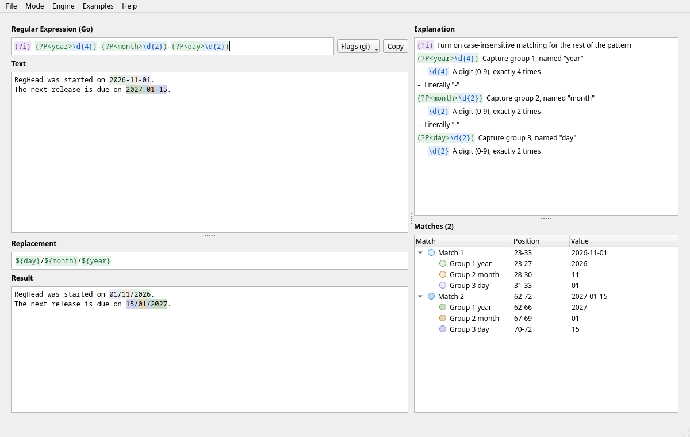

#  RegHead

A desktop regular expression tester, written in Go with a Qt 6 interface using the
[miqt](https://github.com/mappu/miqt) bindings.



## Features

- **Three engines.** Go, PCRE2 and JavaScript. The flags, the
  replacement syntax, the explanation and what Copy gives all follow the engine
  chosen. See [Engines](#engines).
- **Live matching.** Matches and their groups are highlighted in the text
  as you type, each group in its own colour. Shades alternate so that matches
  that touch can be told apart. A dot beside each row of the match list shows its
  colour.
- **Highlighted regex.** The parts of the pattern are coloured as you type, even
  while it is still incomplete.
- **Substitution.** Enter a replacement and see the resulting text below it.
  References such as `${day}` are highlighted, and in the result each group's text
  has the same colour as in the text.
- **Plain language explanation.** A pane breaks the pattern down, step by step,
  exactly as you typed it, with each syntax highlighted fragment followed by
  what it does.
- **Hover to connect them.** Point at a group in the regex or a reference in the
  replacement to light it up in the text, the result and the match list, in every
  match. Point at a match in the text or the result, or a row of the list, to light
  up that match and its group everywhere else. Outside a group it is the whole
  match.
- **Match list.** A pane lists each match and its groups with their positions in
  characters. Click a row to select it in the text. Up to 5,000 matches are
  listed and highlighted; the count and substitution always cover them all.
- **Flags.** A dropdown beside the regex field sets the flags the engine has. See
  [Flags](#flags).
- **Themes.** Follow the system, light or dark, in File > Settings > User
  interface.
- **Examples.** The Examples menu has a submenu for each engine, showing what that
  engine can do. Choosing one fills in the regex, text, flags, mode, engine and
  replacement, replacing what you had entered.
- **Remembers everything.** The window size, pane sizes, column widths, theme,
  mode, engine, flags, pattern, text and replacement. Changes to what you enter, and
  to the engine, are saved within a second, so they survive even a crash.

## Menus

| Menu     | Items                                                  |
| -------- | ------------------------------------------------------ |
| File     | Settings (Ctrl+,), Quit (Ctrl+Q)                       |
| Mode     | Match (Ctrl+1), Substitution (Ctrl+2)                  |
| Engine   | Go, PCRE2, JavaScript                                  |
| Examples | Patterns to try, in a submenu for each engine          |
| Help     | About (Ctrl+I)                                         |

## Flags

Flags are set from the dropdown, which offers those of the engine chosen. Switching
engine keeps the flags the two share.

With the Go engine, flags are written into the regex field as a prefix such as
`(?im)`, which cannot be edited there. Global has no inline form, as it only decides
how many matches are looked for. If you type or paste flags at the very start of a
pattern, they are moved to the dropdown. Flags further into a pattern, such as
`a(?i)b`, and scoped or negative forms, such as `(?i:a)` or `(?-i)`, are part of the
regex and stay where they are.

PCRE2 and JavaScript write flags after the pattern, so they add nothing to the field.

The Copy button copies the regex in full, as it would be written in code, as does
selecting the whole field and pressing Ctrl+C:

| Engine      | Copied          |
| ----------- | --------------- |
| Go          | `(?i)pattern`   |
| PCRE2       | `/pattern/i`    |
| JavaScript  | `/pattern/gi`   |

## Colours

Syntax highlighting has its own colours, for matches and for the parts of a pattern.
The rest of the interface follows the theme.

## Engines

| Engine | What runs | Flags | In a replacement |
| ------ | --------- | ----- | ---------------- |
| Go | Go's own [`regexp`](https://pkg.go.dev/regexp/syntax) | `g i m s U` | `$1`, `${name}`, `$$` |
| PCRE2 | The real PCRE2, through Qt's `QRegularExpression` | `g i m s x U u` | `$1`, `${1}`, `\1`, `$0`, `\\` |
| JavaScript | A simulation on [regexp2](https://github.com/dlclark/regexp2) | `g i m s u y` | `$1`, `$<name>`, `$&`, `` $` ``, `$'`, `$$` |

**Go** runs in linear time and has no backreferences or lookaround. Use `${1}x`
rather than `$1x`, as Go reads the latter as a group named `1x`.

**PCRE2** is the real engine, with lookaround, backreferences, atomic groups,
possessive repeats and recursion. It needs nothing beyond Qt, which always runs it in
UTF mode, so positions and `.` go by character. It stops a pattern that backtracks too
much, and RegHead says so.

**JavaScript** is simulated: patterns are translated to mean the same on regexp2, a
pure Go backtracking engine, including JavaScript's ASCII `\d`, `\w` and `\b`, its
Unicode `\s`, its `$`, its line breaks, `[]`, `[^]`, group numbering and references to
groups that took no part. It stops a search after two seconds and says so. It has
been checked against the documented behaviour, not against a browser, and these
differ from a real engine:

- It always works on whole characters, as JavaScript does only with `u`, so without
  it `.` takes a whole emoji rather than half of one.
- A group in a repeat keeps its last capture, where JavaScript clears it on each
  repetition.
- Case-insensitive matching follows regexp2's rules, which differ from JavaScript's
  for a few characters.
- The `d` and `v` flags are not offered.

## Desktop entry

On Linux, RegHead installs itself in your desktop's applications each time it starts,
so that it can be started from the menus and kept in a dock, with its icon. It writes
`~/.local/share/applications/reghead.desktop` and
`~/.local/share/icons/hicolor/256x256/apps/reghead.png`, or the same under
`$XDG_DATA_HOME`. The entry starts the copy you last ran.

## Settings

Settings are kept as plain JSON in `settings.json`, in a `reghead` folder in the
system's configuration directory: `~/.config/reghead/` on Linux. They include
the text being tested, and the file is readable only by you.

## Downloads

The [releases](https://github.com/nomad-software/reghead/releases) have:

- **Linux:** an AppImage that runs on most systems without installing anything. Make
  it executable and run it.
- **macOS on Apple Silicon:** a disk image, to drag the app into Applications. It is
  not signed with a Developer ID, so macOS will not open it at first: open it, then
  choose Open Anyway in System Settings > Privacy & Security.

## Building

You need Go 1.27, a C++ compiler, `pkg-config` and the Qt 6 development
libraries. The first build compiles the Qt bindings and takes several minutes.

```sh
make build       # Builds ./reghead
make run         # Builds and runs it
make test        # Runs the tests with the race detector
make vet         # Runs go vet
make fuzz        # Fuzzes the engines; the first run takes minutes to compile
make screenshot  # Renders docs/screenshot.png
make appimage    # Packs an AppImage into build/
make macos       # Builds a disk image into build/, on a Mac
make icons       # Remakes the macOS icon from the program's icon
```

## Licence

GNU GPL version 3. See [LICENSE](LICENSE).
